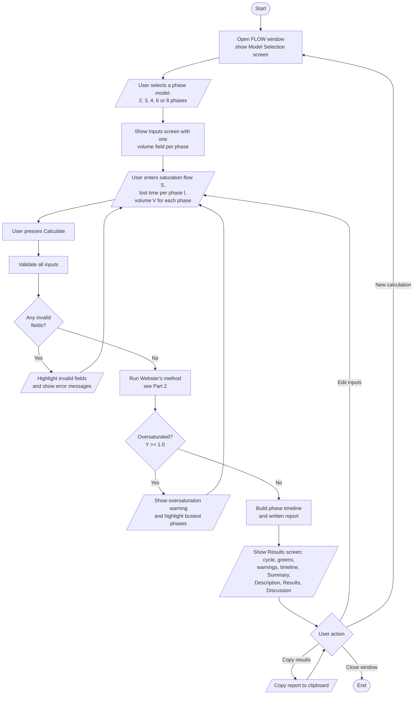
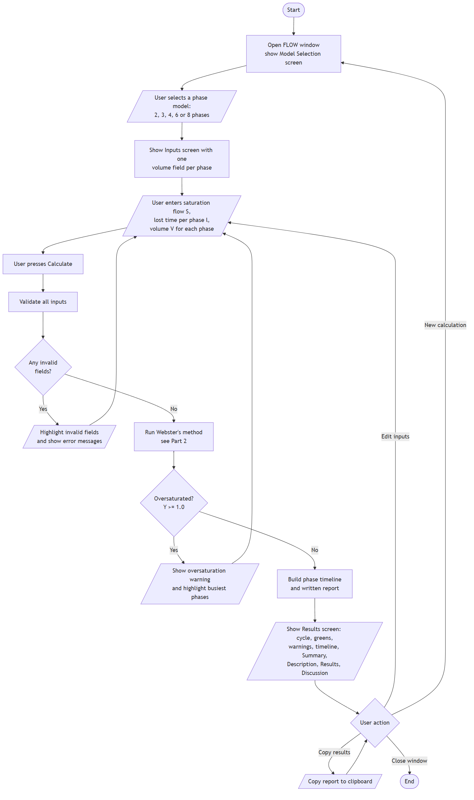
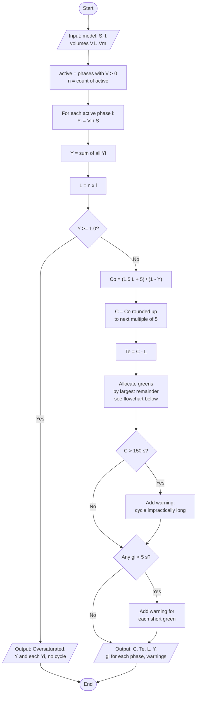
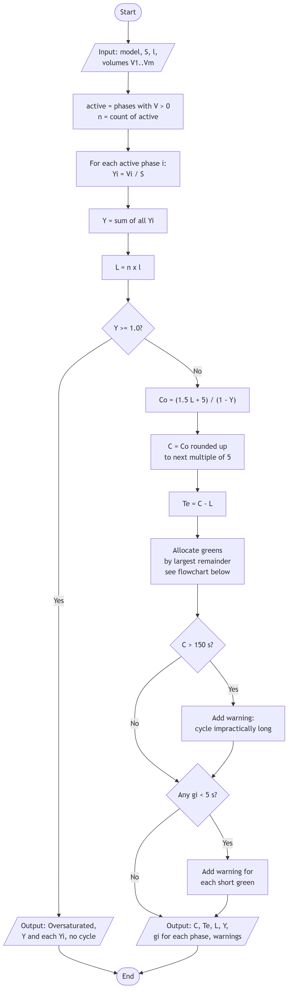
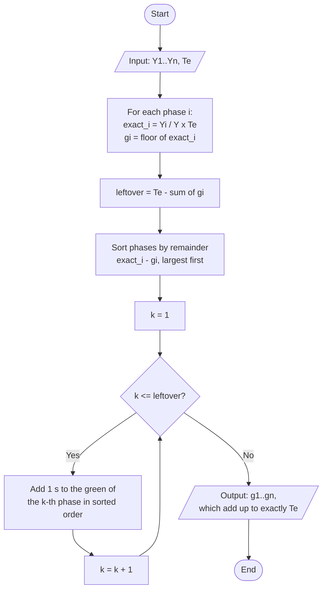

# FLOW: Program Flowchart and Algorithm

This document describes how FLOW works, in two parts:

1. **The program**: what the user does, from opening the app to reading the results.
2. **The algorithm**: Webster's method as FLOW runs it, with an explanation, a flowchart and pseudocode.

The flowcharts are written in Mermaid, which GitHub renders as diagrams. Each one also has a PNG copy in [docs/images](images) for reports and slides. Standard flowchart shapes are used: rounded boxes for Start and End, slanted boxes for input and output, rectangles for processes and diamonds for decisions.

---

## Part 1: Program flowchart

### Explanation

FLOW has three screens: **Model selection**, **Inputs** and **Results**.

1. The app opens on the model selection screen. The user picks one of five phase models (2, 3, 4, 6 or 8 phases).
2. The inputs screen asks for the saturation flow rate, the lost time per phase and one traffic volume for each phase in the chosen model.
3. When the user presses **Calculate**, the inputs are validated. Any invalid field is highlighted with a message. Nothing the user typed is cleared, so they fix the field and press Calculate again.
4. Valid inputs go to the calculation engine (Webster's method, Part 2).
5. If the intersection is oversaturated (`Y >= 1.0`), the app shows a warning naming the busiest phases and returns the user to the inputs to lower demand or change the phasing.
6. Otherwise, the results screen shows the cycle length, effective green, green per phase, any warnings, the phase timeline and the written Summary, Description, Results and Discussion.
7. From the results the user can copy the report, edit the inputs (back to step 2) or start a new calculation (back to step 1). Closing the window ends the program.

### Flowchart



PNG version:



### Pseudocode

```text
PROGRAM FLOW
    OPEN window
    LOOP
        DISPLAY model selection screen
        INPUT model                              // 2, 3, 4, 6 or 8 phases

        LOOP                                     // input and retry loop
            DISPLAY input form for model
            INPUT S, l, V[1..n]
            WAIT FOR Calculate

            (data, errors) <- VALIDATE(model, S, l, V)
            IF errors is not empty THEN
                HIGHLIGHT each invalid field with its message
                CONTINUE                         // keep values, ask again
            END IF

            result <- WEBSTER(data)              // see Part 2
            IF result.oversaturated THEN
                DISPLAY "Oversaturated: Y >= 1.0" and the busiest phases
                CONTINUE                         // user lowers demand
            END IF

            timeline <- BUILD_TIMELINE(result, l)
            DISPLAY results, timeline and written report

            action <- WAIT FOR user action
            WHILE action = "Copy results"
                COPY report to clipboard
                action <- WAIT FOR user action
            END WHILE

            IF action = "Edit inputs" THEN CONTINUE           // back to the form
            IF action = "New calculation" THEN EXIT inner loop
            IF action = "Close window" THEN STOP
        END LOOP
    END LOOP
END PROGRAM
```

### Input validation rules

| Input | Rule |
|---|---|
| Saturation flow `S` | Required, a number, greater than 0, at most 2400 veh/hr |
| Lost time per phase `l` | Required, a whole number of seconds, from 1 to 12 |
| Each volume `Vi` | Required, a number, not negative, at most 5000 veh/hr |
| All volumes together | At least one volume must be greater than 0 |

A comma typed as a decimal point (`1,5`) is accepted as `1.5`.

---

## Part 2: Algorithm (Webster's method)

### Explanation

Webster's method finds the fixed-time signal cycle that keeps total vehicle delay close to its minimum. FLOW applies it in eight steps.

**Step 1: Keep only the active phases.**
A phase with a volume of 0 has no demand, so it is left out of the cycle. `n` is the number of phases that remain.

**Step 2: Flow ratio of each phase.**
The flow ratio compares demand with capacity:

`Yi = Vi / S`

where `Vi` is the phase volume (veh/hr) and `S` is the saturation flow rate (veh/hr).

**Step 3: Total flow ratio.**

`Y = Y1 + Y2 + ... + Yn`

**Step 4: Total lost time.**
Every phase loses `l` seconds to amber and all-red, so:

`L = n x l`

**Step 5: Oversaturation check.**
If `Y >= 1.0`, demand is equal to or greater than what the intersection can serve. Webster's formula divides by `1 - Y`, which would be zero or negative, so there is no valid cycle. The algorithm stops and reports oversaturation.

**Step 6: Optimal cycle length.**
Webster's formula gives:

`Co = (1.5 L + 5) / (1 - Y)`

The result is rounded **up** to the next multiple of 5 seconds, since signal controllers run on round values and rounding down would leave too little time.

**Step 7: Effective green time.**
The part of the cycle that is actually green:

`Te = C - L`

**Step 8: Green time per phase.**
Effective green is shared in proportion to each phase's flow ratio:

`gi = (Yi / Y) x Te`

Each `gi` has to be a whole number of seconds, and the greens must still add up to exactly `Te`. FLOW uses **largest-remainder rounding**: round every green down, then give the leftover seconds one at a time to the phases with the largest fractional parts.

**Warnings.** After a valid result, FLOW also warns when:
- the cycle is longer than 150 s (impractically long, `Y` is close to 1.0), or
- any phase gets less than 5 s of green.

**Timeline.** Phases run one after another. Each phase shows red until its turn, then its green, then `l` seconds of yellow/all-red, then red for the rest of the cycle.

### Worked example

2-Phase, `S = 1900` veh/hr, `l = 4` s, NS = 850 veh/hr, EW = 600 veh/hr.

| Step | Calculation | Result |
|---|---|---|
| 1 | Both volumes are above 0 | `n = 2` |
| 2 | `Y_NS = 850 / 1900`, `Y_EW = 600 / 1900` | `0.4474`, `0.3158` |
| 3 | `Y = 0.4474 + 0.3158` | `0.7632` |
| 4 | `L = 2 x 4` | `8 s` |
| 5 | `0.7632 < 1.0` | not oversaturated |
| 6 | `Co = (1.5 x 8 + 5) / (1 - 0.7632)` | `71.78 s`, rounded up to `75 s` |
| 7 | `Te = 75 - 8` | `67 s` |
| 8 | `g_NS = 0.4474 / 0.7632 x 67 = 39.28`, `g_EW = 0.3158 / 0.7632 x 67 = 27.72` | floors are 39 and 27; 1 second is left over and goes to EW (remainder 0.72 beats 0.28), so `NS = 39 s`, `EW = 28 s` |

Timeline over the 75 s cycle:

| Phase | Green | Yellow/All-Red | Red |
|---|---|---|---|
| NS | 0 to 39 s | 39 to 43 s | 43 to 75 s |
| EW | 43 to 71 s | 71 to 75 s | 0 to 43 s |

### Flowchart



PNG version:



#### Green allocation (largest-remainder rounding)



PNG version:


### Pseudocode

```text
ALGORITHM WEBSTER(model, S, l, V)
    // Input:  model phases, saturation flow S (veh/hr),
    //         lost time per phase l (s), volume V[p] for each phase p (veh/hr)
    // Output: cycle C, effective green Te, green g[i] per active phase, warnings

    // Step 1: active phases
    active <- empty list
    FOR EACH phase p IN model.phases DO
        IF V[p] > 0 THEN APPEND p TO active
    END FOR
    n <- LENGTH(active)

    // Steps 2 and 3: flow ratios
    Y <- 0
    FOR i <- 1 TO n DO
        y[i] <- V[active[i]] / S
        Y <- Y + y[i]
    END FOR

    // Step 4: total lost time
    L <- n * l

    // Step 5: oversaturation check
    IF Y >= 1.0 THEN
        RETURN "Oversaturated", Y, y[1..n]
    END IF

    // Step 6: Webster's optimal cycle, rounded up to 5 s
    Co <- (1.5 * L + 5) / (1 - Y)
    C  <- CEILING(Co / 5) * 5

    // Step 7: effective green
    Te <- C - L

    // Step 8: green per phase
    g[1..n] <- ALLOCATE_GREENS(y[1..n], Y, Te)

    // Warnings
    warnings <- empty list
    IF C > 150 THEN
        APPEND "Cycle is impractically long" TO warnings
    END IF
    FOR i <- 1 TO n DO
        IF g[i] < 5 THEN
            APPEND "Phase " + active[i] + " has less than 5 s green" TO warnings
        END IF
    END FOR

    RETURN C, Te, L, Y, y[1..n], g[1..n], warnings
END ALGORITHM


ALGORITHM ALLOCATE_GREENS(y[1..n], Y, Te)
    // Shares Te in proportion to y[i] using whole seconds
    // that still add up to exactly Te.
    FOR i <- 1 TO n DO
        exact[i] <- y[i] / Y * Te
        g[i]     <- FLOOR(exact[i])
    END FOR

    leftover <- Te - SUM(g[1..n])
    order    <- indices 1..n sorted by (exact[i] - g[i]), largest first

    FOR k <- 1 TO leftover DO
        g[order[k]] <- g[order[k]] + 1
    END FOR

    RETURN g[1..n]
END ALGORITHM


ALGORITHM BUILD_TIMELINE(C, l, g[1..n])
    // Phases run in sequence: green, then yellow/all-red, then red.
    start <- 0
    FOR i <- 1 TO n DO
        finish <- start + g[i] + l
        RED          from 0           to start     (only if start > 0)
        GREEN        from start       to start + g[i]
        YELLOW/ALL-RED from start + g[i] to finish
        RED          from finish      to C         (only if finish < C)
        start <- finish
    END FOR
END ALGORITHM
```

### Where this lives in the code

| Part | File | Function |
|---|---|---|
| Input validation | [core/validation.py](../core/validation.py) | `validate_inputs` |
| Webster's method (Steps 1 to 8) | [core/calculator.py](../core/calculator.py) | `compute_timing` |
| Green allocation | [core/calculator.py](../core/calculator.py) | `apportion_greens` |
| Cycle rounding | [core/calculator.py](../core/calculator.py) | `round_cycle` |
| Warnings | [core/calculator.py](../core/calculator.py) | `_build_warnings` |
| Phase timeline | [core/visualizer.py](../core/visualizer.py) | `build_timeline` |
| Screen flow | [ui/app.py](../ui/app.py), [ui/screens/input_form.py](../ui/screens/input_form.py) | `FlowApp.show`, `InputFormScreen._calculate` |
